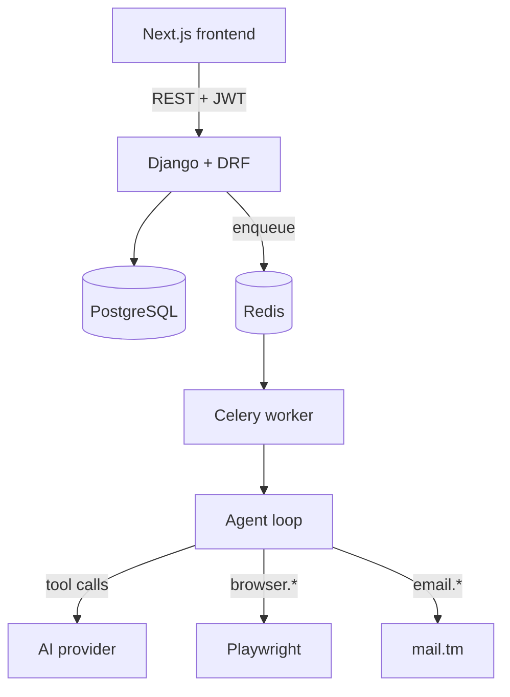

# Temporary Identity Agent

An AI agent that completes legitimate website registration using a
generated temporary identity — temp email, random name, strong
password — fills the form, verifies via a real disposable mailbox, and
hands you the resulting credentials in a private vault.

**It never attempts to bypass CAPTCHA, Cloudflare, SMS/KYC/age/payment
verification, or any other security or anti-abuse mechanism.** When one
appears, the job pauses and asks a human to complete it.

## Features

- Real cryptographically-secure identity + password generation (`secrets`, not `random`)
- Real disposable mailbox provisioning + verification-link/OTP extraction (mail.tm)
- Structured page inspection (DOM → JSON) — the AI agent never sees raw HTML
- A fully allowlisted tool surface — no code-execution tool exists, by design
- Encrypted-at-rest credentials (Fernet), scrubbed (not just flagged) on expiry/delete
- Domain policy (block/allow/human-required), per-user rate limits, audit logging throughout
- Full async job pipeline: Django + DRF → Celery/Redis → Playwright → AI provider
- Next.js frontend with live job progress, resumable CAPTCHA/human-action flow, and a credential vault

## Architecture



See `docs/architecture.md` for the full request-flow walkthrough and
state machine.

## Technology stack

Next.js/TypeScript/Tailwind (frontend) · Django/DRF (backend) ·
PostgreSQL · Redis + Celery (async jobs) · Playwright (browser
automation) · a pluggable AI provider abstraction, currently wired to
Agent Router · a pluggable email provider abstraction, currently wired
to mail.tm.

## Quickstart

```bash
cp .env.example .env
# fill in DJANGO_SECRET_KEY, CREDENTIAL_ENCRYPTION_KEY, AGENT_ROUTER_*
docker compose -f docker/docker-compose.yml up --build
```

Or without Docker — see `docs/development.md` for full setup, both
backend and frontend.

## Documentation

| Doc | Covers |
|---|---|
| [`docs/architecture.md`](docs/architecture.md) | System diagram, request flow, state machine, layering |
| [`docs/development.md`](docs/development.md) | Local setup, running tests, mock sites |
| [`docs/api.md`](docs/api.md) | Every endpoint |
| [`docs/ai-agent.md`](docs/ai-agent.md) | Provider abstraction, tool registry, agent loop |
| [`docs/browser-automation.md`](docs/browser-automation.md) | Page inspection, allowlisted actions, real bugs found while building it |
| [`docs/email.md`](docs/email.md) | mail.tm integration, extraction logic |
| [`docs/security.md`](docs/security.md) | Full threat model, the AI security boundary explained precisely |
| [`docs/deployment.md`](docs/deployment.md) | Docker, production builds, what's verified vs. not |
| [`docs/troubleshooting.md`](docs/troubleshooting.md) | Common setup failures |
| [`docs/testing.md`](docs/testing.md) | What's covered, and an honest account of what isn't (and why) |

## Responsible use

This project is built for legitimate privacy/convenience use — signing
up for a service without handing over a personal email, on sites that
already offer open self-service registration. It will not, and by
design cannot, defeat a website's actual security or identity
verification. If you're integrating this against real target sites,
respect their terms of service; `DomainPolicy` exists so an
administrator can block or human-gate domains where automated
registration isn't appropriate.

## Honest limitations

This was built end-to-end with heavy real verification at every phase
(pytest suite, real cross-process integration tests, real `npm run
build`, real DOM tests via `jsdom`) — but a few things could not be
verified in the sandbox this was built in, and are disclosed rather
than glossed over:

- No live Chromium available → browser actions verified via mocked
  Playwright contracts + real DOM tests (jsdom), not a live page.
- No live network access to Agent Router or mail.tm → both providers
  verified against documented/realistic schemas, not live calls.
- No Docker daemon available → Dockerfiles verified via real parsers
  and path checks, not an actual `docker build`.

Each of these has a concrete next step documented in `docs/testing.md`
and `docs/deployment.md` for verifying it in your own environment
before relying on it in production.
