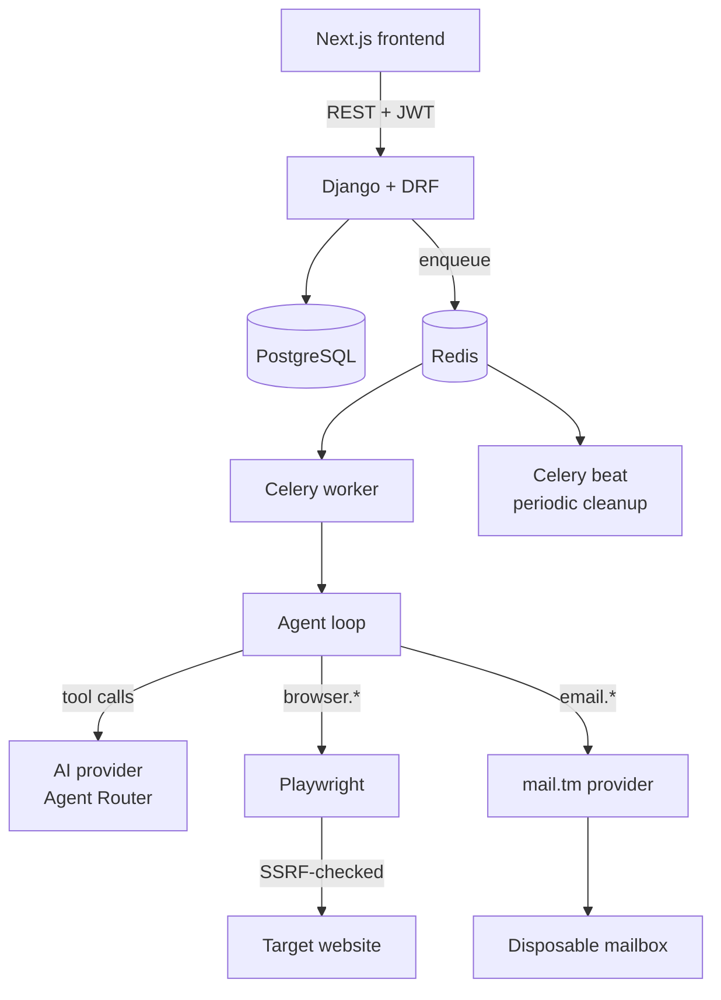

# Architecture

## System overview



## Request flow: creating a registration job

1. `POST /api/registration-jobs/` — the URL is validated through the
   real SSRF guard (`apps/common/url_safety.py`) before anything is
   created.
2. A `RegistrationJob` row is created in state `QUEUED`, and
   `run_registration_job_task.delay()` enqueues Celery work — the HTTP
   request returns immediately (`apps/registration/tasks.py`).
3. The Celery worker calls `apps.registration.orchestration.start_registration_job()`,
   which checks the domain policy and per-user rate limits, then hands
   off to `AgentRunner` (`apps/ai_agent/agent_loop.py`).
4. `AgentRunner` opens a real Playwright browser session
   (`apps/browser/playwright_client.py`) and runs the tool-calling loop:
   send the system prompt + tool definitions to the AI provider, execute
   whatever tool calls come back through the validated dispatcher
   (`apps/ai_agent/dispatcher.py`), persist a `RegistrationStep` per
   action, repeat until a terminal or resumable state — or
   `MAX_AGENT_STEPS`/`MAX_JOB_DURATION_SECONDS` is hit.
5. On `registration.mark_complete`, a `TemporaryAccount` vault entry is
   created, linking the job's identity + website.

## State machine

```
QUEUED → STARTING → OPENING_SITE → ANALYZING → IDENTITY_CREATED →
FILLING_FORM → SUBMITTING → WAITING_FOR_EMAIL → VERIFYING → COMPLETED
```

Branches at any point to `CAPTCHA_REQUIRED` / `HUMAN_ACTION_REQUIRED`
(resumable — see below), or `FAILED` / `CANCELLED` / `EXPIRED`
(terminal). Enforced via `RegistrationJob.TERMINAL_STATES`,
`RESUMABLE_STATES`, and `ACTIVE_STATES` (the last of which is what
counts against a user's concurrency quota).

## Resume model (known simplification)

When the agent hits a CAPTCHA or other human-required step, the
Playwright browser session is **closed** (not kept alive across the
pause) — `ManagedBrowserSession` always closes on `__exit__`. On
resume, `AgentRunner.run(resume=True)` reuses the **existing identity
and mailbox** but opens a fresh browser session and re-navigates to
the registration URL, instructing the model to re-inspect the page
rather than assume prior form state.

This is a deliberate MVP trade-off, not an oversight: keeping a
Playwright session alive across an arbitrarily long human-response
window would need a persistent CDP connection (`connect_over_cdp`) and
out-of-band session lifecycle management — the same category of
complexity the original spec explicitly told us not to force into the
MVP for live browser streaming. Documented here as a clear Phase 2
candidate rather than silently built halfway.

## Layering

- **`apps/common`** — cross-cutting: base model, exception taxonomy,
  encryption, SSRF guard, `IsOwner` permission. Everything else depends
  on this; it depends on nothing else in the project.
- **`apps/identities`, `apps/email_service`** — identity/mailbox
  generation and persistence, each with a `service.py` that both the
  DRF API and the AI tools call — one code path, not two.
- **`apps/browser`** — Playwright lifecycle, page inspection (DOM →
  structured JSON), and the allowlisted action functions. This is the
  *entire* surface the agent can act through.
- **`ai/`** — provider-agnostic chat/tool schemas, the Agent Router
  implementation, and the system prompt. Nothing here is Django-specific
  except the settings lookup.
- **`apps/ai_agent`** — the tool registry (Pydantic-validated), the
  dispatcher (the actual security boundary), and the reasoning loop.
- **`apps/registration`** — job model/state machine, orchestration
  (domain policy + rate limits), Celery tasks, and the job API.
- **`apps/accounts`** — the vault: metadata endpoints plus the audited
  reveal-credentials action.

## Why a modular monolith

Per the original scope decision: no microservices, no Kubernetes, no
message bus beyond Redis/Celery, no separate browser-automation
service. Next.js → Django → Postgres/Redis/Celery/Playwright/AI
provider/email provider, one deployable backend. Split out a service
only when there's a demonstrated need — there isn't one yet.
